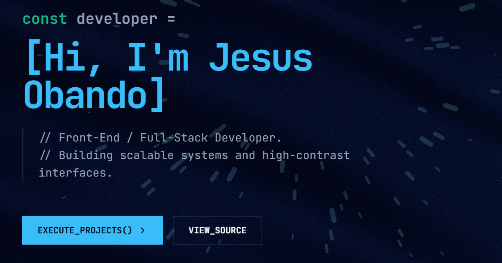

<div align="center">


# Jesús Obando · Portafolio

**Construyendo sistemas escalables e interfaces claras.**

[](https://jesusobando32.github.io)


<br />



</div>

<br />

## Qué es

Mi portafolio personal, con estética de terminal en azul oscuro. Está en español e inglés y tiene dos vistas:

- **Inicio:** presentación, sobre mí, experiencia, tecnologías y un carrusel con mis proyectos.
- **Cuadrícula de proyectos** (`#/proyectos`): los 6 proyectos juntos, con mi rol, mi parte, tecnologías y enlace al código.

## Detalles

- Transición animada entre el inicio y la cuadrícula.
- Efectos de [React Bits](https://reactbits.dev): texto que se descifra, revelado al hacer scroll, banda de tecnologías que reacciona al scroll, tarjeta con inclinación, botones magnéticos y chispas al hacer clic.
- Fondo de partículas solo en escritorio, y se pausa si la pestaña no está visible.
- Respeta `prefers-reduced-motion`.
- Responsivo, con barra de acción propia para móvil.
- Cambio de idioma ES / EN.

## Estructura

```text
src/
├── components/      Secciones, navegación, carrusel y página de proyectos
│   └── rb/          Componentes de React Bits adaptados
├── data/portfolio.js  Contenido en español e inglés (proyectos, experiencia, textos)
└── App.jsx          Rutas por hash y transiciones
public/              Logo, vista previa, CVs, robots y sitemap
```

Todo el contenido vive en `src/data/portfolio.js`: para añadir o editar un proyecto basta con tocar ese archivo.

## Cómo correrlo

```bash
npm install
npm run dev
```

| Comando | Qué hace |
| --- | --- |
| `npm run dev` | Servidor de desarrollo |
| `npm run build` | Compila a `dist/` |
| `npm run preview` | Sirve la compilación para probarla |
| `npm run lint` | Revisa el código con Oxlint |
| `npm run deploy` | Publica `dist/` en la rama `gh-pages` |

> En Windows, si `npm run deploy` falla con "Filename too long", usa una caché corta:
> `CACHE_DIR=/c/ghp-cache npx gh-pages -d dist`

## Decisiones

- **Rutas con `#`:** GitHub Pages no reescribe URLs, así que la cuadrícula vive en `#/proyectos` y funciona sin servidor.
- **Un solo canvas WebGL**, solo en escritorio, para cuidar el rendimiento.

<div align="center">

<br />

Hecho por [Jesús Obando](https://github.com/jesusobando32)

</div>
